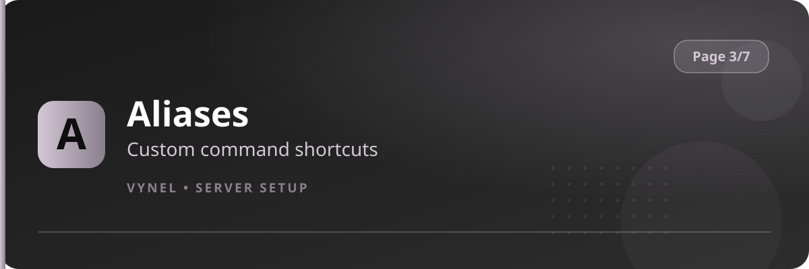

<Frame>
  
</Frame>

Aliases are custom names for existing commands. Make `ui` mean `userinfo`, or `p` mean `play` — for the whole server or just for yourself.

## Setup from the panel

<Steps>
  <Step title="Open the panel">
    `{prefix}setup` → **Page 3** → click **Aliases**.
  </Step>
  <Step title="Add a server alias">
    Click **Add**, then in the form type the **command** and the **alias word**. Submit.
  </Step>
  <Step title="Use it">
    `{prefix}ui` now runs `userinfo` for everyone in the server.
  </Step>
  <Step title="Remove">
    **Remove** on the panel deletes a server alias.
  </Step>
</Steps>

## With commands

```
{prefix}aliases add <command>            → new server-wide alias
{prefix}aliases remove <command>         → delete it
{prefix}aliases list                     → show server aliases

{prefix}aliases self add <command>       → personal alias (you only)
{prefix}aliases self remove <command>    → delete it
{prefix}aliases self list                → your aliases
```

<Info>
  Personal aliases win over server aliases, and server aliases win over the built-in command name — so the same word can mean different things to different members.
</Info>

<Tip>
  Keep aliases short and unique to your server (`sr` for serverrank, `w` for warn). A good alias cuts the most-used command in half.
</Tip>
