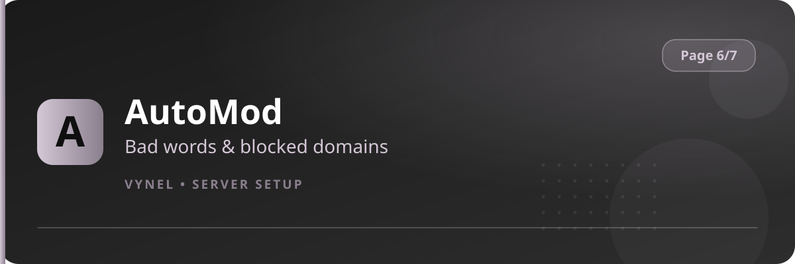

<Frame>
  
</Frame>

AutoMod watches member messages and blocks what you forbid — a **bad-words** list and **blacklisted domains/links**. Offending messages are removed and the member can be actioned.

<Info>
  AutoMod is part of Vynel's protection suite and works together with Discord's native AutoMod. On the panel the entry may appear greyed until the feature is available for your server.
</Info>

## Configure it

<Steps>
  <Step title="Open the entry">
    `{prefix}setup` → **Page 6** → **AutoMod**.
  </Step>
  <Step title="Add bad words">
    Register the words/phrases to block. Messages containing them are auto-deleted.
  </Step>
  <Step title="Blacklist domains">
    Add domains whose links should be stripped (spam sites, invite shorteners, etc.).
  </Step>
  <Step title="Review">
    Blocked attempts surface in your **Logs Server** channel if you enabled automod log types.
  </Step>
</Steps>

<Warning>
  Blocking is only as good as your list — test a few words after adding them, and keep the list focused so ordinary chat isn't caught by mistake.
</Warning>
