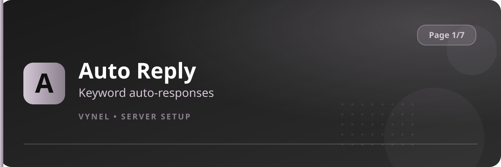

<Frame>
  
</Frame>

Auto Reply watches your server for keywords or phrases and responds with a message you wrote — perfect for FAQs like rules, giveaways, or role links.

## Setup from the panel

<Steps>
  <Step title="Open the panel">
    `{prefix}setup` → **Page 1** → click **Auto Reply**.
  </Step>
  <Step title="Add a response">
    Click **Add**, then in the form type the **trigger** (the word or phrase) and the **reply** (what Vynel should say). Submit.
  </Step>
  <Step title="Test it">
    Say the trigger word in any channel — Vynel answers instantly with your reply.
  </Step>
  <Step title="Remove">
    Use **Remove** on the panel to delete a response.
  </Step>
</Steps>

## With commands

```
{prefix}autoreply add <trigger> <reply>   → create a rule
{prefix}autoreply remove <trigger>        → delete a rule
{prefix}autoreply list                    → show all rules
```

<Tip>
  Triggers match as whole words or phrases, so a trigger of `rules` answers messages containing the word rules. Keep replies short — one line reads best.
</Tip>

<Info>
  Auto Reply respects disabled commands: if `autoreply` is switched off for a channel (Page 6 → Manage Command), rules won't fire there.
</Info>
