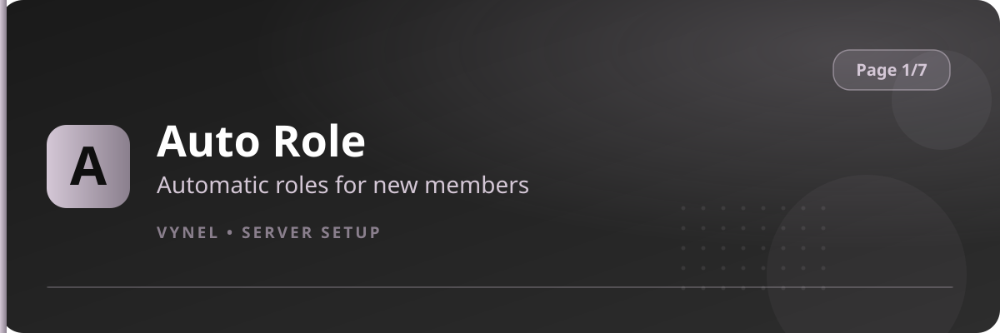

<Frame>
  
</Frame>

Auto Role hands members roles the moment they join, and can tie roles to specific **invite links** so people who arrive through a friend's invitation get a bonus role.

## Setup from the panel

<Steps>
  <Step title="Open the panel">
    `{prefix}setup` → **Page 1** → click **Auto Role**. Your current auto roles appear.
  </Step>
  <Step title="Add a join role">
    Click **Add**, type the role (mention, ID or name) in the form, and **Submit**. Every new member now receives it.
  </Step>
  <Step title="Add an invite role (optional)">
    Click **Add** again to bind a role to an invite code — members who join through that invite get the role.
  </Step>
  <Step title="Remove">
    Use **Remove** and pick the role from the dropdown, or `{prefix}autorole remove <@role>`.
  </Step>
</Steps>

## With commands

```
{prefix}autorole <@role|role ID|role name>   → add a join role
{prefix}autorole remove <@role>              → remove a join role
{prefix}autorole list                        → show current auto roles
```

<Info>
  Standard servers can register up to **2 invite roles** across up to **3 tracked invites**; the panel tells you when a limit is reached. Roles must be **below** Vynel's top role in the member list or Discord won't let it assign them.
</Info>

<Tip>
  Keep join roles low-power (color, nickname permission, basic view). Reserve staff and premium roles for other systems.
</Tip>
