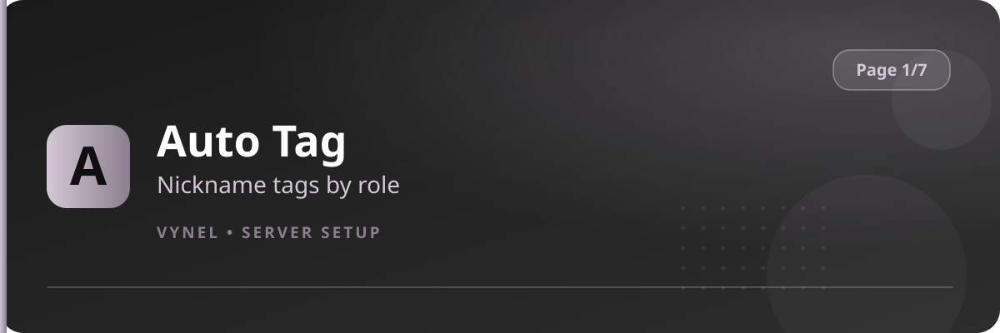

<Frame>
  
</Frame>

Auto Tag keeps nicknames tidy: bind a tag such as `ᴅᴇsɪɢɴ` or a clan prefix to a role, and every member who gets that role is renamed automatically.

## Setup from the panel

<Steps>
  <Step title="Open the panel">
    `{prefix}setup` → **Page 1** → click **Auto Tag**.
  </Step>
  <Step title="Add a tag rule">
    Click **Add**, fill the form with the **role** and the **tag**, and **Submit**. Existing holders of the role are re-tagged as the rule applies.
  </Step>
  <Step title="Stack more rules">
    Add one rule per role. A member who holds several tagged roles keeps the most recently applied one.
  </Step>
  <Step title="Remove">
    Click **Remove** and pick the rule, or use the command below.
  </Step>
</Steps>

## With commands

```
{prefix}autotag add <@role> <tag>     → every holder of the role gets the tag
{prefix}autotag remove <@role>        → delete the rule for that role
{prefix}autotag list                  → current rules
```

<Warning>
  Vynel needs the **Manage Nicknames** permission, and the role being tagged must be manageable (below Vynel's top role).
</Warning>
