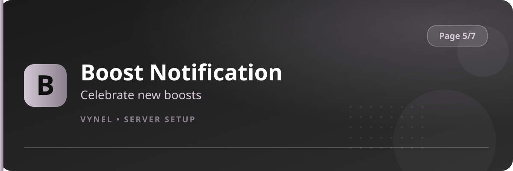

<Frame>
  
</Frame>

When a member boosts your server, Vynel posts a thank-you card in the channel you choose — with the booster, the new boost count, and an optional mention.

## Setup from the panel

<Steps>
  <Step title="Open the panel">
    `{prefix}setup` → **Page 5** → click **Boost Notification**.
  </Step>
  <Step title="Add the channel">
    Click **Add**, enter the channel for boost announcements, **Submit**.
  </Step>
  <Step title="Customize the message (optional)">
    Set your own text with the command below, including whether boosted-by mentions are on.
  </Step>
  <Step title="Remove">
    **Remove** stops the announcements.
  </Step>
</Steps>

## With commands

```
{prefix}boost channel <#channel|ID>            → where to post
{prefix}boost message <text> [--pingable on|off]  → custom text and mention toggle
```

<Info>
  Boost cards light up the member's profile too — Vynel recognizes the server-booster badge, so the celebration always names the right person even if they leave and rejoin.
</Info>

<Tip>
  Keep it short and loud so the celebration feels like one. Leave `--pingable on` if you want the booster mentioned in the announcement channel; turn it off for a quieter `#boosts` feed.
</Tip>
