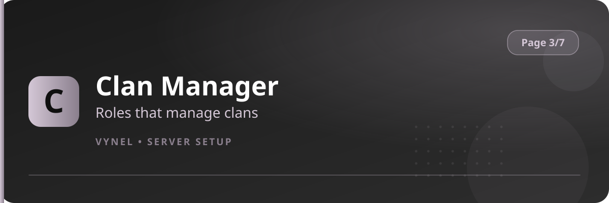

<Frame>
  
</Frame>

The clan system lets members form teams with their own ranks and points. **Clan Manager** chooses which staff roles are allowed to run it.

## Setup from the panel

<Steps>
  <Step title="Open the panel">
    `{prefix}setup` → **Page 3** → click **Clan Manager**. Current manager roles appear.
  </Step>
  <Step title="Add a manager role">
    Click **Add**, enter the role in the form, **Submit**. Members holding that role unlock the clan admin commands.
  </Step>
  <Step title="Remove">
    **Remove** takes the power away.
  </Step>
</Steps>

## With commands

```
{prefix}clanmanager <@role|roleID|rolename>          → add a manager role
{prefix}clanmanager leader <@role>                   → designate the leader role
{prefix}clanmanager coleader <@role>                 → designate the co-leader role
{prefix}clanmanager remove <leader|coleader|@role>   → unregister
```

<Info>
  Members use clan commands (`clan`, `members`, `leaders`, `managers`, `coleaders`) without any setup — Clan Manager only governs the **staff-side** of the system: reviewing, forcing updates, and fixing clans.
</Info>
