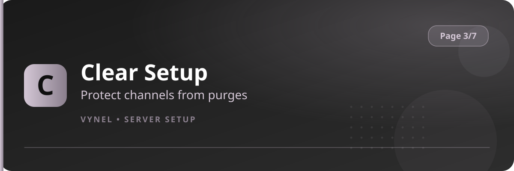

<Frame>
  
</Frame>

By default `{prefix}clear` can delete messages in any channel staff can manage. **Clear Setup** puts selected channels off-limits, so announcements, rules, or ticket transcripts can't be wiped by accident — or on purpose by a rogue mod.

## Setup from the panel

<Steps>
  <Step title="Open the panel">
    `{prefix}setup` → **Page 3** → click **Clear Setup**.
  </Step>
  <Step title="Add a protected channel">
    Click **Add**, pick the channel in the form. That channel is now immune to `{prefix}clear`.
  </Step>
  <Step title="Remove">
    **Remove** lets a channel be cleared again.
  </Step>
</Steps>

## With commands

```
{prefix}clearsetup add <#channel|category_id|category_name>   → protect
{prefix}clearsetup remove <#channel|number>                   → unprotect
{prefix}clearsetup list                                       → show protected channels
```

<Info>
  You can protect an entire **category** at once by passing a category ID or name — every channel inside it inherits the protection.
</Info>

<Warning>
  Protection applies to Vynel's `{prefix}clear` command only. Discord's own delete and other bots' purge tools aren't affected.
</Warning>
