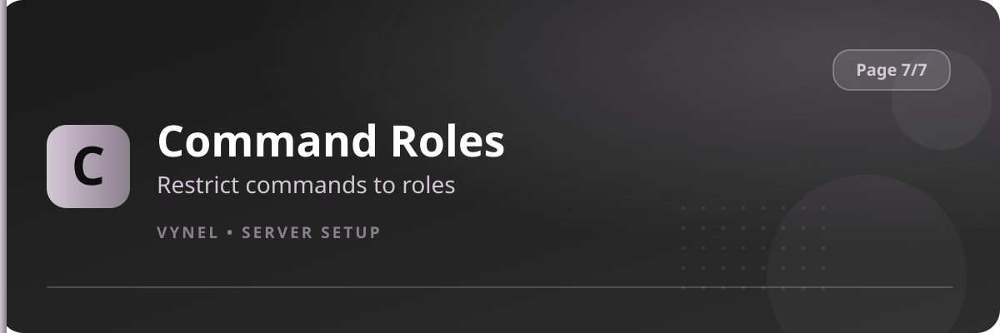

<Frame>
  
</Frame>

Command Roles locks sensitive moderation and role commands behind specific roles. Instead of trusting everyone with `ban` or `temprole`, you decide exactly which roles may run each one.

## Setup from the panel

<Steps>
  <Step title="Open the panel">
    `{prefix}setup` → **Page 7** → click **Command Roles**.
  </Step>
  <Step title="Pick a command">
    Choose the moderation or role command you want to restrict.
  </Step>
  <Step title="Add allowed roles">
    Click **Add** and enter the role(s) that are permitted to use it. Only members holding one of those roles can now run the command.
  </Step>
  <Step title="Remove">
    **Remove** a role to revoke it, or clear the command's list to open it back up.
  </Step>
</Steps>

<Info>
  Server Administrators and the owner can always run commands — Command Roles is about scoping power for non-admin staff, not locking yourself out.
</Info>

<Warning>
  Don't restrict a command and then forget to add a role for it — the safest order is: add the allowed roles first, then the restriction takes effect on the next command use.
</Warning>

<Tip>
  Typical split: `Trial Mod` may use `warn`/`mute`, full `Moderator` adds `ban`/`jail`/`clear`, and only `Admin` touches `temprole` and role tools.
</Tip>
