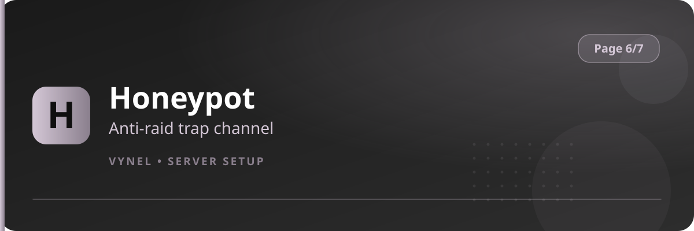

<Frame>
  
</Frame>

Honeypot is an anti-raid defense. Vynel creates a channel that **normal members can never see or join**. Bots and raiders that force their way in are instantly and silently dealt with.

## How it works

1. Vynel sets up a hidden channel with permissions no legitimate user can access.
2. If an account appears in that channel — a sign it's a hijacked/automated raider — Vynel **soft-bans** it (removes access without a visible ban).
3. The action is quiet, so raid tools don't learn they've been caught.

## Setup from the panel

<Steps>
  <Step title="Open the panel">
    `{prefix}setup` → **Page 6** → click **Honeypot**.
  </Step>
  <Step title="Add the trap channel">
    Click **Add** and select (or let Vynel create) the channel that becomes the honeypot.
  </Step>
  <Step title="Leave it alone">
    The channel should stay invisible to members — do not add people to it. It works purely as a tripwire.
  </Step>
</Steps>

<Warning>
  Never grant any real role access to the honeypot channel. Its whole purpose is that only forced/automated joins can reach it.
</Warning>

<Info>
  Combine with **Logs Server** so soft-ban events are recorded and you can review what the trap caught.
</Info>
