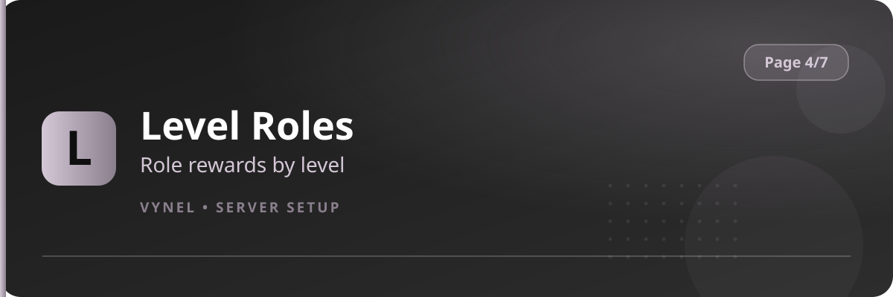

<Frame>
  
</Frame>

Level Roles turns activity into progression: choose a role and the level it unlocks at, and Vynel hands it out automatically when members level up.

## Setup from the panel

<Steps>
  <Step title="Open the panel">
    `{prefix}setup` → **Page 4** → click **Level Roles**. Existing reward tiers are listed.
  </Step>
  <Step title="Add a reward">
    Click **Add**, fill the form with the **role** and the **level number**, **Submit**.
  </Step>
  <Step title="Stack tiers">
    Add one entry per milestone — e.g. Level 5 `Active`, Level 20 `Regular`, Level 50 `Legend`.
  </Step>
  <Step title="Bypass list (optional)">
    Use the **Bypass** add button to register roles (like staff) that should never receive level roles.
  </Step>
  <Step title="Remove">
    **Remove** deletes a tier or a bypass entry.
  </Step>
</Steps>

## With commands

```
{prefix}levelroles add <@role> <level>   → create a reward tier
{prefix}levelroles remove <@role>        → delete it
{prefix}levelroles list                  → all tiers
```

<Info>
  Levels grow from chat and voice activity. Members see their progress with `{prefix}rank`, and Vynel posts a level-up card when they cross a threshold.
</Info>

<Warning>
  Reward roles must sit **below** Vynel's top role. If a member somehow holds a lower-tier and higher-tier role, the higher one wins.
</Warning>
