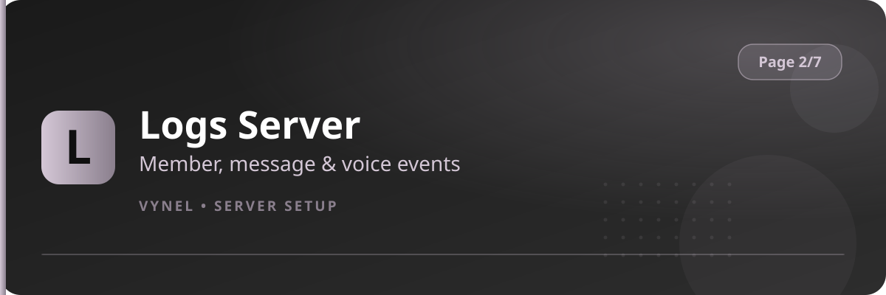

<Frame>
  
</Frame>

Logs Server turns Vynel into your server's black box. You choose **which events** to track and **which channel** each stream lands in.

## What can be logged

Member joins / leaves / bans / kicks / timeouts, role changes, nickname changes, message edits / deletes / pins, channel and role create / update / delete, emoji and sticker changes, invites, webhooks, voice join / leave / move / mute, threads, and server updates.

## Setup from the panel

<Steps>
  <Step title="Open the panel">
    `{prefix}setup` → **Page 2** → click **Logs Server**.
  </Step>
  <Step title="Pick an event category">
    Use the **category dropdown** (members, messages, roles, voice…) to load that group of events.
  </Step>
  <Step title="Choose a channel">
    For each event type, select an existing channel from the dropdown — or press **Create channel** and Vynel makes a private log channel for you.
  </Step>
  <Step title="Toggle">
    Any assigned stream can be switched **on / off** without deleting it; **Remove** clears an assignment.
  </Step>
</Steps>

## Viewing

```
{prefix}logs view     → summary of what is assigned where
```

<Info>
  Log messages use the same clean card style as the rest of Vynel, with your Theme accent color, who did it, when, and what changed.
</Info>

<Tip>
  Route all logs into one private category so staff can audit a single place; separate only the noisy streams (message edits) into their own channel.
</Tip>
