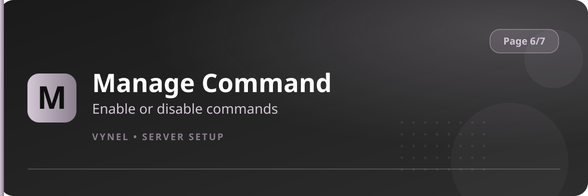

<Frame>
  
</Frame>

Manage Command is your control board for which Vynel commands are allowed, and where. Disable noisy commands in `#serious` channels, or turn a feature off entirely.

## Setup from the panel

<Steps>
  <Step title="Open the panel">
    `{prefix}setup` → **Page 6** → click **Manage Command**.
  </Step>
  <Step title="Find the command">
    The panel lists command groups so you can locate the one you want.
  </Step>
  <Step title="Disable or enable">
    Choose **server-wide** or a single **channel**. Vynel confirms the change.
  </Step>
</Steps>

## With commands

```
{prefix}command disable <command> [#channel]   → turn off (optionally one channel)
{prefix}command enable <command> [#channel]    → turn back on
{prefix}command disablecommand <#channel|all> <command>
{prefix}command enablecommand <#channel|all> <command>
{prefix}command list                           → what is currently disabled
```

<Info>
  A disabled command simply stops responding in its scope — no error, no half-working behavior. Members in an allowed channel are unaffected.
</Info>

<Tip>
  Common uses: disable `play`/music outside voice-adjacent channels, disable meme/image commands in announcement or staff channels, and keep `clear`/`ban` available only where staff operate.
</Tip>
