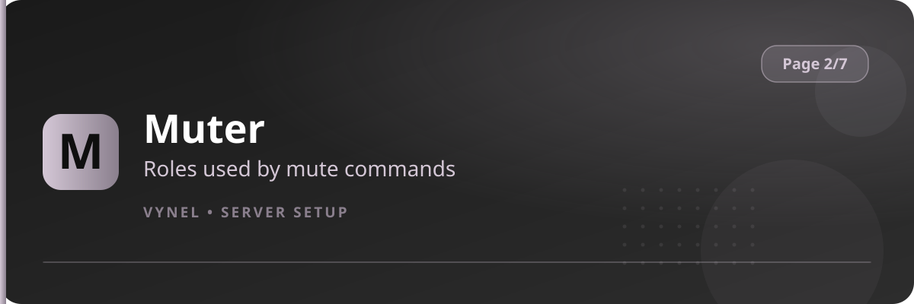

<Frame>
  
</Frame>

Before anyone can be muted, Vynel needs to know **which role is the mute role**. The Muter feature registers one or more muter roles — text-mute, voice-mute, or a combined one.

## Setup from the panel

<Steps>
  <Step title="Open the panel">
    `{prefix}setup` → **Page 2** → click **Muter**. Your current muter roles are listed.
  </Step>
  <Step title="Add a muter role">
    Click **Add**, type the role in the form, **Submit**. Done — `{prefix}mute @user` now uses it.
  </Step>
  <Step title="Remove">
    Click **Remove**, pick the role, confirm.
  </Step>
</Steps>

## With commands

```
{prefix}muter <@role|roleID|rolename>   → register a muter role
{prefix}muter remove <@role>            → unregister it
```

<Warning>
  The mute role must exist in Discord with **Send Messages** denied (and **Speak / Mute Members** where voice matters). Vynel only assigns the role — the permissions live on the role itself. Also make sure the role sits below Vynel's highest role.
</Warning>

<Tip>
  Pair this with **setmuted** (`{prefix}setmuted`) to designate the voice channel muted members are moved to, so voice mutes are visible too.
</Tip>
