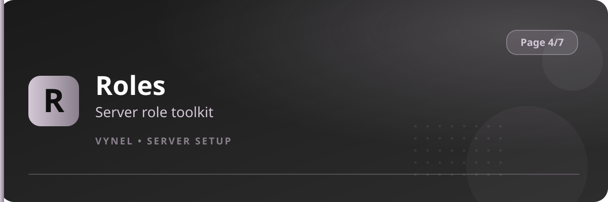

<Frame>
  
</Frame>

The **Roles** button on Page 4 is the hub for Vynel's role toolkit — everything role-related that isn't owned by another feature lives here.

## What you can configure

- **Self-roles** — publish a panel where members pick roles by button or dropdown (`{prefix}rolemanager`)
- **Role requests** — categories members can request from staff (`rolerequest`)
- **Claim roles** — roles members claim by doing a task (`{prefix}claimroles`)
- **Temp roles** — time-limited role grants (`{prefix}temprole @user <time> <@role>`)
- **Role tools** — `{prefix}roleadd` / `{prefix}roleremove` / `{prefix}rolecolor` / `{prefix}roleicon` / `{prefix}rolename` for staff management

## Setup from the panel

<Steps>
  <Step title="Open the hub">
    `{prefix}setup` → **Page 4** → click **Roles**.
  </Step>
  <Step title="Pick the tool">
    The hub presents the role systems as buttons — each opens its own setup flow with **Add** / **Remove**.
  </Step>
  <Step title="Publish">
    Most flows end by posting a member-facing panel (self-roles menu, claim panel) in a channel you choose.
  </Step>
</Steps>

<Info>
  Setting up a role system here is optional — commands like `{prefix}role add <@role>` for self-roles work as soon as a role is registered, and `{prefix}rolelist` shows members what's available.
</Info>

<Tip>
  Keep self-role panels in a dedicated `#roles` channel with slow mode on; buttons get spammed when a shiny new color role appears.
</Tip>
