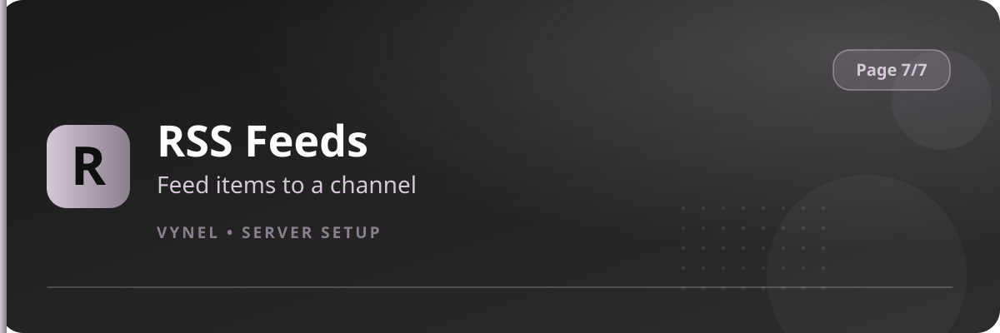

<Frame>
  
</Frame>

RSS Feeds turns any syndicated source — blogs, news, patch notes, YouTube channels with RSS — into automatic posts in your server.

## Setup from the panel

<Steps>
  <Step title="Open the panel">
    `{prefix}setup` → **Page 7** → click **RSS Feeds**.
  </Step>
  <Step title="Add a feed">
    Click **Add** and fill the form with the **feed URL** and the **target channel**. Submit.
  </Step>
  <Step title="Wait for new items">
    Vynel checks the feed on a schedule and posts each new entry as it appears — title, link, and preview.
  </Step>
  <Step title="Manage">
    Use the panel list to add more feeds or **Remove** ones you no longer want.
  </Step>
</Steps>

<Info>
  Only **new** items are posted after you subscribe — existing backlog isn't dumped into the channel, so setup never causes a flood.
</Info>

<Tip>
  One feed per channel keeps things tidy (e.g. `#news` for a site, `#patch-notes` for a game). Point several feeds at one channel only when they belong together.
</Tip>
