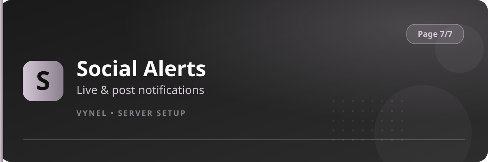

<Frame>
  
</Frame>

Social Alerts notifies your channel the moment someone you follow goes **live** or publishes a **post**.

| Type | Platforms |
|---|---|
| Live stream alerts | Twitch · Kick · YouTube · TikTok |
| New post alerts | YouTube · TikTok · X |

## Setup from the panel

<Steps>
  <Step title="Open the panel">
    `{prefix}setup` → **Page 7** → click **Social Alerts**.
  </Step>
  <Step title="Choose stream or post">
    The panel separates **Stream** alerts (go-live) from **Post** alerts (new upload/tweet). Pick the Add button for the type you want.
  </Step>
  <Step title="Add the creator">
    In the form, enter the **channel** to announce into and the **creator** (their channel/handle/URL). Submit.
  </Step>
  <Step title="Repeat">
    Add as many streamers/creators as you like, each with its own target channel.
  </Step>
  <Step title="Remove">
    Use **Remove** to stop watching a creator.
  </Step>
</Steps>

<Info>
  Alerts carry the stream title or post preview with a link and your Theme accent color, so they match the rest of the bot.
</Info>

<Tip>
  Send alerts to a dedicated `#lives` or `#new-videos` channel rather than general chat — members can mute the feed channel without losing the rest of the server.
</Tip>
