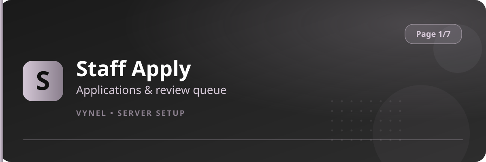

<Frame>
  
</Frame>

Staff Apply publishes an application panel in a channel of your choice. Members apply through a form; staff review and accept or reject from a queue.

## Setup from the panel

<Steps>
  <Step title="Open the panel">
    `{prefix}setup` → **Page 1** → click **Staff Apply**.
  </Step>
  <Step title="Choose where applications go">
    Add the **application channel** (where new apps are posted) and the **post channel** (where the public apply panel is placed), using the **Add** buttons and their forms.
  </Step>
  <Step title="Publish the panel">
    Vynel posts an **Apply** panel in the channel you chose. Members press it, fill the form (age, experience, availability…), and submit.
  </Step>
  <Step title="Review">
    Each application appears in the app channel with **Accept** / **Reject** buttons for your staff. Accepting can grant the configured applicant role.
  </Step>
</Steps>

## With commands

```
{prefix}verificator / staff apply panel commands accept the same channels —
most owners configure everything through the panel UI above.
```

<Warning>
  Keep the application channel private — only staff should see incoming forms. The public apply panel belongs in a member-facing channel.
</Warning>

<Tip>
  Pair Staff Apply with **Command Roles** (Page 7) so new staff only unlock the commands they actually need.
</Tip>
