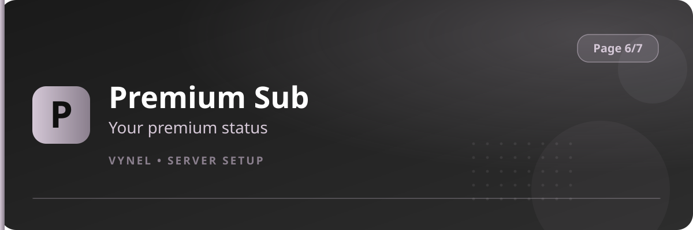

<Frame>
  
</Frame>

Some Vynel capabilities — noprefix, extra auto-role slots, advanced protection, priority limits — are gated behind a **server premium subscription**. This panel shows your current status.

## Check your status

<Steps>
  <Step title="Open the entry">
    `{prefix}setup` → **Page 6** → **Premium Server Sub**.
  </Step>
  <Step title="Read the card">
    Vynel shows whether your server is subscribed, what's included, and any remaining time.
  </Step>
</Steps>

## With commands

```
{prefix}subscription    → your server's premium status
{prefix}premium         → what premium unlocks
```

<Info>
  When a limit is hit (for example too many auto invite-roles for a free server), the panel names the limit — upgrading lifts it without any reconfiguration.
</Info>

<Tip>
  Before upgrading, decide which premium feature you actually want (noprefix and extra protection slots are the common ones) so you only pay for what you use.
</Tip>
