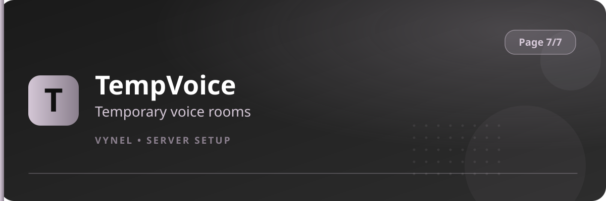

<Frame>
  
</Frame>

TempVoice gives everyone a personal voice channel. A member joins a **"+" lobby**, Vynel spawns a private channel they own, and it disappears when they leave.

## Setup from the panel

<Steps>
  <Step title="Open the panel">
    `{prefix}setup` → **Page 7** → click **TempVoice**.
  </Step>
  <Step title="Set the category">
    Click the **category** Add button and enter the voice category where temp channels are created.
  </Step>
  <Step title="Set the lobby / name format">
    Configure the **join-to-create lobby** channel and the default **name format** for created rooms through their Add forms.
  </Step>
  <Step title="Done">
    Members join the lobby to get their own room automatically.
  </Step>
</Steps>

## What owners can do in a temp room

Once they own a channel, members get buttons to:

- **Rename** the room
- **Change user limit**
- **Lock** the room (private) or unlock it
- **Move** members in/out, and **invite** friends

<Info>
  Temp channels are deleted the instant their owner and all listeners leave — the category stays clean without any manual pruning.
</Info>

<Tip>
  Put the lobby at the top of a `Voice Lounge` category so joining it is the obvious way to start a private call.
</Tip>
