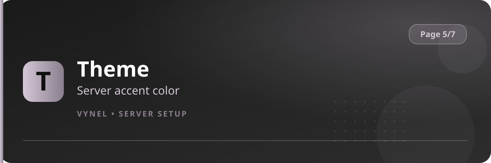

<Frame>
  
</Frame>

Theme is the fastest way to make Vynel feel like *yours*. One color tints every panel, notice, log card and answer the bot posts in your server.

## Setup from the panel

<Steps>
  <Step title="Open the panel">
    `{prefix}setup` → **Page 5** → click **Theme**.
  </Step>
  <Step title="Pick a color">
    Enter your color in the form and submit — every future Vynel message uses it immediately.
  </Step>
</Steps>

## With commands

```
{prefix}theme <color>    → set the accent color
{prefix}theme reset      → back to Vynel's brand color
{prefix}theme            → show the current color
```

Accepted formats: `#RRGGBB`, `RRGGBB`, `0xRRGGBB`, or a decimal value.

<Info>
  The default brand color is a soft lilac — `#d4c7d6`. Reset returns to it at any time; nothing else about your setup changes.
</Info>

<Tip>
  Choose a color that stays readable on Discord's dark theme — mid-brightness tones (teal, lilac, gold) look sharper than pure black or neon.
</Tip>
