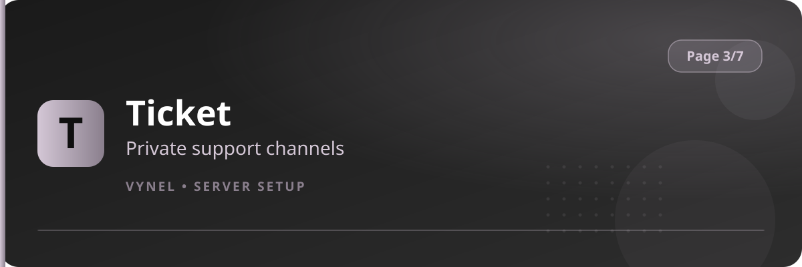

<Frame>
  
</Frame>

The Ticket system posts a public panel; members press a button, choose a category, and Vynel opens a **private channel** just for them and your staff.

## Setup from the panel

<Steps>
  <Step title="Open the panel">
    `{prefix}setup` → **Page 3** → click **Ticket**.
  </Step>
  <Step title="Add a category">
    Click **Add** and fill the form with the category name, description, and which staff role should see tickets in it.
  </Step>
  <Step title="Choose where the panel lives">
    Set the channel where the public ticket panel is posted.
  </Step>
  <Step title="Publish">
    Vynel posts the panel with a **Create Ticket** button and a category dropdown.
  </Step>
</Steps>

## Day-to-day

- Members press **Create Ticket**, pick a category, and get `ticket-username` in that category.
- The ticket shows **Close** and **Claim** buttons — staff can claim ownership of a ticket.
- Closing archives the conversation and hides the channel.
- `{prefix}showthread` / thread history lets staff reopen a member's last ticket if needed.

<Warning>
  Make sure the staff role you assign can **View Channel** inside the category you choose, or nobody will see incoming tickets.
</Warning>

<Tip>
  Three categories are plenty: **General**, **Report**, **Partnership**. More categories make the dropdown crowded for members.
</Tip>
