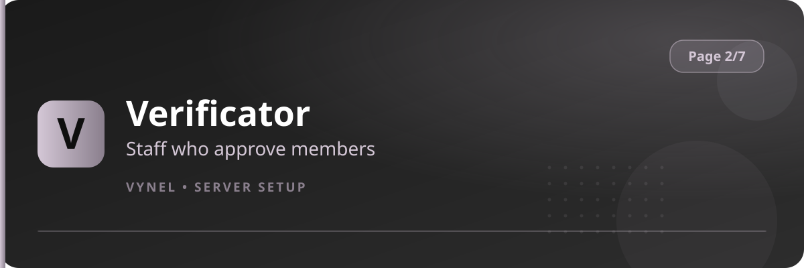

<Frame>
  
</Frame>

In verification-gated servers, **Verificators** are the staff who decide whether a newcomer gets in. This feature registers the role that holds that power.

## Setup from the panel

<Steps>
  <Step title="Open the panel">
    `{prefix}setup` → **Page 2** → click **Verificator**. Registered verificator roles are listed.
  </Step>
  <Step title="Add a verificator role">
    Click **Add**, enter the staff role, **Submit**. Everyone holding that role can now review applicants.
  </Step>
  <Step title="Remove">
    **Remove** unregisters a role.
  </Step>
</Steps>

## How verificators work day-to-day

```
{prefix}vg   → approve the waiting member (Good)
{prefix}vb   → reject the waiting member (Bad)
```

- Pending members appear in the verification queue for verificators to review.
- `{prefix}veriflogs` shows every past decision — who approved whom, and when.
- `{prefix}resetverificators` clears the current queue if it gets stuck.
- A weekly leaderboard celebrates your most active verificators.

<Warning>
  Only give the verificator role to trusted staff — `vg` grants server access, so treat it like a moderation power.
</Warning>
