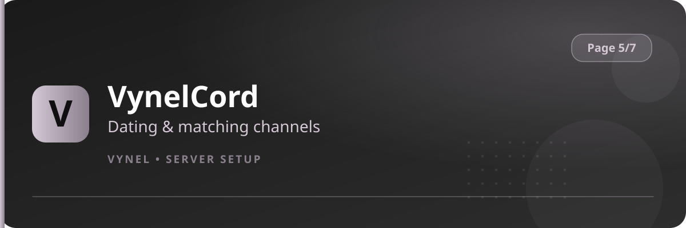

<Frame>
  
</Frame>

VynelCord is Vynel's built-in matching system — profiles, swiping, matches, and private threads. This feature points the system at **your** channels.

## Setup from the panel

<Steps>
  <Step title="Open the panel">
    `{prefix}setup` → **Page 5** → click **VynelCord**.
  </Step>
  <Step title="Set the profile channel">
    Use the **Add** form to register the channel where new member profiles are posted.
  </Step>
  <Step title="Set the match channel">
    Register the channel where new matches are announced.
  </Step>
  <Step title="Done">
    Members can now create their profile and start matching; VynelCord commands are open to everyone.
  </Step>
</Steps>

## What members do

```
{prefix}tindercord            → create / edit their profile card
{prefix}matches               → see their matches
{prefix}thread                → open a private VynelCord thread with a match
```

<Info>
  Profile cards use the same visual language as the rest of Vynel — photo, name, age, intentions and bio, with your Theme accent color on the card border.
</Info>

<Warning>
  Keep the profile channel civil: moderation commands from Page 2 (mute, jail) still apply inside VynelCord channels.
</Warning>
