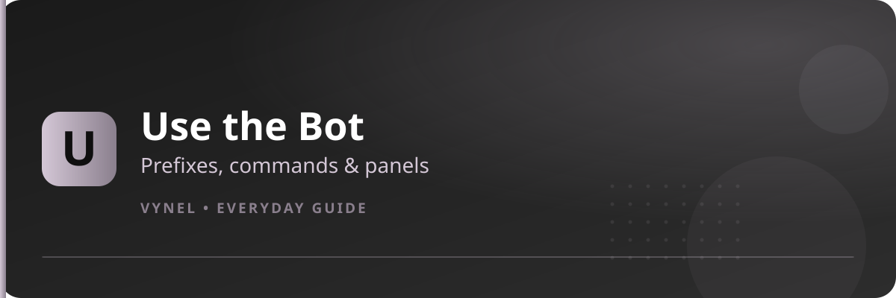

<Frame>
  
</Frame>

Once the server is set up, using Vynel is just typing commands — or pressing buttons.

## Prefixes

Vynel answers to text commands with a prefix:

- The **server prefix** is set on Page 4 of the Setup Panel (`{prefix}prefix <new>`).
- `{prefix}help` shows the current prefix and every command you can use.
- Premium servers can enable **noprefix** — then plain words like `setup` or `play` work directly.
- Your own **personal prefix** and **aliases** can override the server defaults (`{prefix}aliases`).

```
{prefix}setup          → opens the Setup Panel
{prefix}help           → command list + current prefix
{prefix}help userinfo  → help for one command
```

## Command categories

| Category | Examples | What you get |
|---|---|---|
| Information | `userinfo` · `serverinfo` · `channelinfo` · `permissions` | Rich profile & server cards |
| Moderation | `ban` · `kick` · `mute` · `jail` · `warn` · `clear` | Staff actions with confirmation |
| Roles | `role` · `roleadd` · `temprole` · `rolemanager` | Self-roles and role tools |
| Levels & Economy | `rank` · `daily` · `balance` · `shop` | XP cards and the RVP economy |
| Music | `play` · `queue` · `loop` · `nowplaying` | Songs in your voice channel |
| Image | `kiss` · `slap` · `avatar` · `banner` | GIF and avatar effects |
| Social | `marry` · `family` · `thread` · `matches` | Relationships and VynelCord |
| Games | `rps` · `blackjack` · `casino` | Mini-games |
| Utility | `afk` · `translate` · `snipe` · `remind` | Daily quality-of-life |

<Tip>
  Any command that needs a member accepts a **mention, an ID, or a name** — `{prefix}userinfo john`, `{prefix}userinfo 123456789012345678`.
</Tip>

## Buttons and panels

Many replies come with buttons instead of text:

- **Panels** (help, role manager, tickets, giveaways) have arrow buttons to page through content.
- **Dropdown menus** appear where there are more choices than buttons allow.
- **Modals** are the pop-up forms — type a value and press **Submit**.
- Panels belong to whoever opened them; other members see the buttons but can't move your panel.

## Staff tools

With the right role, staff get extra power:

- **Jail & Mute** — `{prefix}jail @user` sends members to the jail channel configured on Page 2; `{prefix}mute @user` applies the muter role. `{prefix}unjail` and `{prefix}unmute` reverse them. Logs of every action live in `jaillogs` / `unjaillogs`.
- **Warnings** — `{prefix}warn @user reason`, check with `{prefix}warnings @user`, reset with `{prefix}clearwarnings`.
- **Command roles** (Page 7) let owners restrict powerful commands to specific staff roles.
- **Disabled commands** (Page 6, Manage Command) can be switched off per channel or server-wide.

## Getting unstuck

| Problem | Fix |
|---|---|
| Buttons are grey | The panel locked after 5 minutes — run `{prefix}setup` again |
| "You don't have permission" | Setup needs Administrator or the server owner |
| Command does nothing | It may be disabled for your role or channel (Page 6) |
| Wrong prefix | Check `{prefix}help`, or re-set it on Page 4 |
| Bot silent in a channel | `mute command` on Page 6 may have disabled it there |

<CardGroup cols={2}>
  <Card title="Setup Panel guide" icon="sliders" href="/setup/panel">
    Configure all 28 features.
  </Card>
  <Card title="Feature guides" icon="puzzle-piece" href="/features/autorole">
    Start with Auto Role.
  </Card>
</CardGroup>
