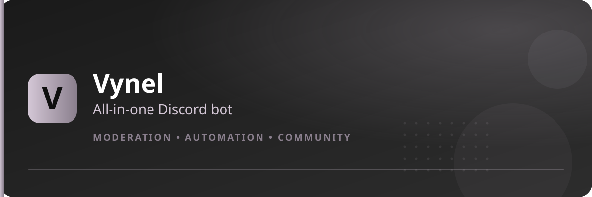

<Frame>
  
</Frame>

**Vynel** is a all-in-one Discord bot: moderation, automation, roles, leveling, tickets, music, social alerts, dating, clans, and more — all managed from a visual **Setup Panel**, no coding required.

## What Vynel does

- **Moderation & protection** — logs, mute, jail, verification, AutoMod, honeypot anti-raid
- **Automation** — auto roles, auto tags, auto replies, counters, welcome & boost messages
- **Community** — tickets, staff applications, level roles, command aliases, role manager
- **Engagement** — VynelCord dating, clans, ranks & XP, music, giveaways
- **Feeds** — live social alerts (Twitch, Kick, YouTube, TikTok, X) and RSS delivery

## How it's organized

Everything configurable is reached through one command:

```
{prefix}setup
```

It opens a panel of **7 pages** covering **28 features**. Only a server **Administrator** (or the server owner) can configure the panel — everyone else can browse it, but every button is disabled.

<CardGroup cols={2}>
  <Card title="How to set up Vynel" icon="rocket" href="/how-to-setup-bot">
    Invite the bot and run your first setup in under 5 minutes.
  </Card>
  <Card title="How to use Vynel" icon="compass" href="/how-to-use-bot">
    Prefixes, commands, panels, buttons and modals.
  </Card>
  <Card title="The Setup Panel" icon="sliders" href="/setup/panel">
    All 7 pages at a glance.
  </Card>
  <Card title="Feature guides" icon="puzzle-piece" href="/features/autorole">
    Step-by-step setup for each of the 28 features.
  </Card>
</CardGroup>

## Permissions

| Who | Can do |
|---|---|
| Server owner / Administrator | Configure everything, run every setup command |
| Members with a configured staff role | Use the moderation commands their role allows |
| Everyone else | Use public commands (info, ranks, images, music…) |
