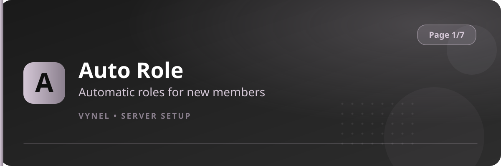

<Frame>
  
</Frame>

Open with `{prefix}setup` (or `{prefix}setup 1`). Page 1 holds the four automation features that run without staff input.

| Feature | Button says | It does |
|---|---|---|
| Auto Role | `Auto Role` | Assigns roles to new members automatically |
| Auto Tag | `Auto Tag` | Applies nickname tags to members by role |
| Auto Reply | `Auto Reply` | Answers trigger words with your canned replies |
| Staff Apply | `Staff Apply` | Publishes a staff application form |

<CardGroup cols={2}>
  <Card title="Auto Role" icon="user-plus" href="/features/autorole">Set up join roles and invite-based roles.</Card>
  <Card title="Auto Tag" icon="tag" href="/features/autotag">Force nicknames per role.</Card>
  <Card title="Auto Reply" icon="reply" href="/features/autoreply">Create keyword auto-responses.</Card>
  <Card title="Staff Apply" icon="clipboard-list" href="/features/staff-apply">Run hiring through Vynel.</Card>
</CardGroup>
