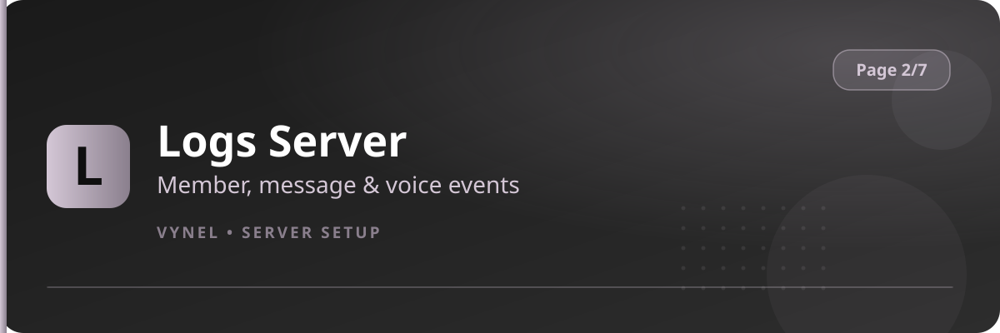

<Frame>
  
</Frame>

Navigate to `{prefix}setup 2`. These four features are the backbone of a safe server — every moderation command Vynel offers reads from what you set here.

| Feature | Button says | It does |
|---|---|---|
| Logs Server | `Logs Server` | Records member, role, channel, message and voice events to your channels |
| Muter | `Muter` | Registers the role(s) used by `mute` / `unmute` |
| Jailer | `Jailer` | Registers the jail role and jail channel for `jail` / `unjail` |
| Verificator | `Verificator` | Registers staff who can approve members with `vg` / `vb` |

<CardGroup cols={2}>
  <Card title="Logs Server" icon="scroll" href="/features/logs">Pick event types and channels.</Card>
  <Card title="Muter" icon="volume-xmark" href="/features/muter">Set mute roles.</Card>
  <Card title="Jailer" icon="lock" href="/features/jailer">Set jail role and channel.</Card>
  <Card title="Verificator" icon="user-check" href="/features/verificator">Set up member verification staff.</Card>
</CardGroup>

<Info>
  Configure this page first — `mute`, `jail`, and verification commands answer with a notice until their roles exist.
</Info>
