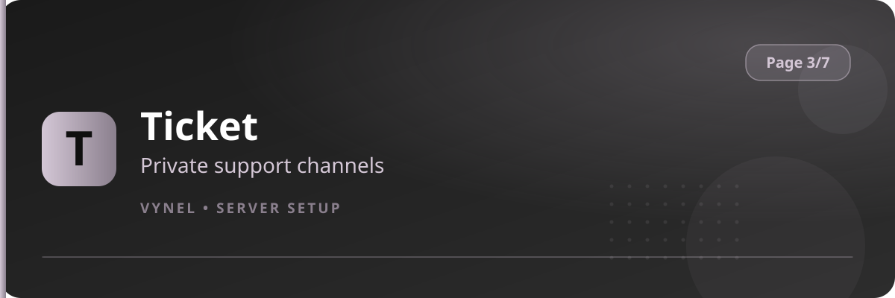

<Frame>
  
</Frame>

`{prefix}setup 3` groups the everyday staff and server-quality features.

| Feature | Button says | It does |
|---|---|---|
| Ticket | `Ticket` | Builds a support-ticket panel with categories |
| Aliases | `Aliases` | Creates shortcut names for any command |
| Clear Setup | `Clear Setup` | Protects channels from `clear`, or copies disabled-command settings |
| Clan Manager | `Clan Manager` | Assigns the roles that can manage clans |

<CardGroup cols={2}>
  <Card title="Ticket" icon="ticket" href="/features/ticket">Private help channels for members.</Card>
  <Card title="Aliases" icon="link" href="/features/aliases">Custom command shortcuts.</Card>
  <Card title="Clear Setup" icon="eraser" href="/features/clear-setup">Guard channels from message purges.</Card>
  <Card title="Clan Manager" icon="shield" href="/features/clan-manager">Who can run the clan system.</Card>
</CardGroup>
