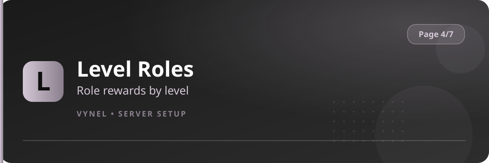

<Frame>
  
</Frame>

`{prefix}setup 4` controls growth: what members earn as they stay active, and how the server presents itself.

| Feature | Button says | It does |
|---|---|---|
| Level Roles | `Level Roles` | Rewards roles automatically at a level threshold |
| Roles | `Roles` | Opens the role settings for the server |
| Counter | `Counter` | Live member / voice counters inside channel names |
| Prefix | `Prefix` | Changes the server's command prefix |

<CardGroup cols={2}>
  <Card title="Level Roles" icon="chart-line" href="/features/level-roles">XP rewards by level.</Card>
  <Card title="Roles" icon="circle-half-stroke" href="/features/roles">Role settings.</Card>
  <Card title="Counter" icon="hashtag" href="/features/counter">Member & voice counters.</Card>
  <Card title="Prefix" icon="keyboard" href="/features/prefix">Set your command prefix.</Card>
</CardGroup>

<Warning>
  If you change the prefix here, every example in these docs uses `{prefix}` — update your muscle memory to the new one.
</Warning>
