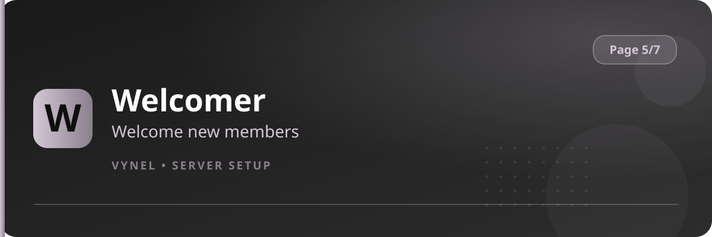

<Frame>
  
</Frame>

`{prefix}setup 5` covers what members see and how the bot looks.

| Feature | Button says | It does |
|---|---|---|
| Welcomer | `Welcomer` | Posts a welcome message when someone joins |
| Boost Notification | `Boost Notification` | Announces new server boosts |
| VynelCord | `VynelCord` | Channels for the VynelCord dating system |
| Theme | `Theme` | The accent color of every Vynel message |

<CardGroup cols={2}>
  <Card title="Welcomer" icon="hand-wave" href="/features/welcomer">Greet new members.</Card>
  <Card title="Boost Notification" icon="rocket" href="/features/boost-notification">Celebrate boosters.</Card>
  <Card title="VynelCord" icon="heart" href="/features/vynelcord">Set the dating channels.</Card>
  <Card title="Theme" icon="palette" href="/features/theme">Your server's accent color.</Card>
</CardGroup>

<Tip>
  Set **Theme** early — the accent color is applied to all panels, notices and cards the moment you save it, so the rest of setup matches your colors.
</Tip>
