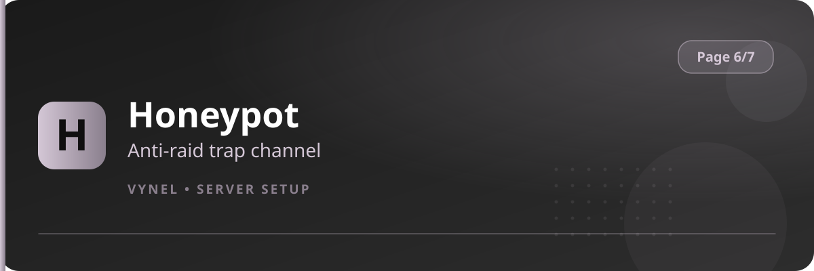

<Frame>
  
</Frame>

`{prefix}setup 6` is the safety and control page — what's blocked, what's allowed, and who's premium.

| Feature | Button says | It does |
|---|---|---|
| AutoMod | `AutoMod` | Bad words & blacklisted domains filter |
| Premium Server Sub | `Premium Server Sub` | Shows your premium subscription status |
| Manage Command | `Manage Command` | Enable or disable any command, server-wide or per channel |
| Honeypot | `Honeypot` | A trap channel that quietly soft-bans compromised accounts |

<CardGroup cols={2}>
  <Card title="AutoMod" icon="broom" href="/features/automod">Filter words and domains.</Card>
  <Card title="Premium Subscription" icon="crown" href="/features/subscription">Check what's unlocked.</Card>
  <Card title="Manage Command" icon="power-off" href="/features/manage-commands">Turn commands on/off.</Card>
  <Card title="Honeypot" icon="spider" href="/features/honeypot">Anti-raid trap channel.</Card>
</CardGroup>

<Info>
  The AutoMod button on the panel is currently shown as disabled — word and domain filtering is managed by Discord's own AutoMod integration inside Vynel's protection suite.
</Info>
