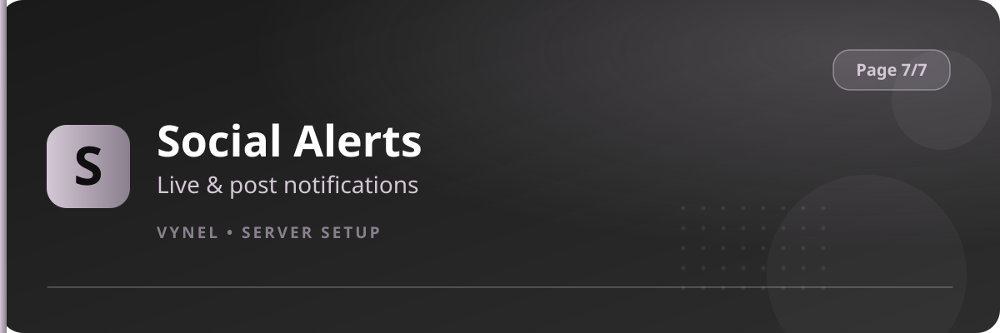

<Frame>
  
</Frame>

`{prefix}setup 7` connects your server to the outside world and shapes its voice experience.

| Feature | Button says | It does |
|---|---|---|
| Social Alerts | `Social Alerts` | Live alerts when streamers go live (Twitch, Kick, YouTube, TikTok) and posts appear (YouTube, TikTok, X) |
| TempVoice | `TempVoice` | Personal temporary voice channels members can create |
| RSS Feeds | `RSS Feeds` | Delivers new articles from any RSS/Atom feed to a channel |
| Command Roles | `Command Roles` | Restricts moderation & role commands to chosen staff roles |

<CardGroup cols={2}>
  <Card title="Social Alerts" icon="tower-broadcast" href="/features/social-alerts">Stream & post notifications.</Card>
  <Card title="TempVoice" icon="microphone" href="/features/tempvoice">User-created voice rooms.</Card>
  <Card title="RSS Feeds" icon="rss" href="/features/rss-feeds">News delivered automatically.</Card>
  <Card title="Command Roles" icon="user-shield" href="/features/command-roles">Who may use which command.</Card>
</CardGroup>
