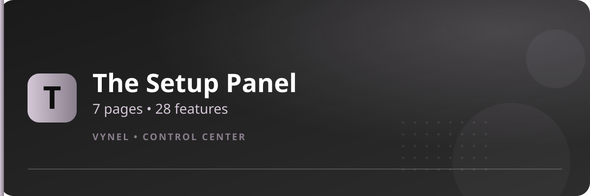

<Frame>
  
</Frame>

`{prefix}setup` opens Vynel's control center. It is the **only** entry point for configuring the bot — there are no per-feature setup subcommands to memorize.

## Panel anatomy

Every page of the panel has the same shape:

1. **Banner image** at the top
2. **Title row** — `Server Setup • Page N/7`
3. **Four feature rows** — each with a short description and a button that opens that feature
4. **◀ / ▶ arrows** — move between the 7 pages

## Rules of the panel

| Rule | Detail |
|---|---|
| Who can configure | Administrator role or the server owner. Everyone else sees disabled buttons. |
| Who can navigate | Only the person who opened the panel. |
| Auto-lock | Buttons grey out after **5 minutes**. Re-run `{prefix}setup` for a fresh panel. |
| Direct jump | `{prefix}setup 5` opens page 5 immediately. |

## The 7 pages

<Columns cols={2}>
  <Column>
    <Card title="Page 1 · Automation & Staff" icon="robot" href="/setup/page-1">
      Auto Role, Auto Tag, Auto Reply, Staff Apply
    </Card>
  </Column>
  <Column>
    <Card title="Page 2 · Moderation Roles" icon="shield-halved" href="/setup/page-2">
      Logs Server, Muter, Jailer, Verificator
    </Card>
  </Column>
  <Column>
    <Card title="Page 3 · Support & Server Tools" icon="ticket" href="/setup/page-3">
      Ticket, Aliases, Clear Setup, Clan Manager
    </Card>
  </Column>
  <Column>
    <Card title="Page 4 · Levels & Roles" icon="chart-line" href="/setup/page-4">
      Level Roles, Roles, Counter, Prefix
    </Card>
  </Column>
  <Column>
    <Card title="Page 5 · Notifications & Theme" icon="bell" href="/setup/page-5">
      Welcomer, Boost Notification, VynelCord, Theme
    </Card>
  </Column>
  <Column>
    <Card title="Page 6 · Protection & Control" icon="lock" href="/setup/page-6">
      AutoMod, Premium Sub, Manage Command, Honeypot
    </Card>
  </Column>
  <Column>
    <Card title="Page 7 · Feeds & Voice" icon="rss" href="/setup/page-7">
      Social Alerts, TempVoice, RSS Feeds, Command Roles
    </Card>
  </Column>
</Columns>

<Info>
  Clicking a feature button never leaves Discord — it opens that feature's own panel with **Add**, **Remove**, and list buttons. Each feature is documented individually in the sidebar.
</Info>
